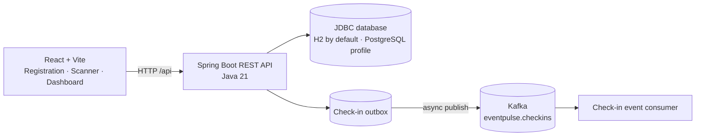

# EventPulse

**Conference check-in, attendance, and reliability — built for the Dash0 + Sonar hackathon.**

EventPulse is a QR-based conference registration and attendance application. Attendees register and receive a unique QR code; event staff scan it in a browser to validate and record check-in. Successful check-ins are also delivered asynchronously to Kafka, demonstrating an event-driven flow that can be observed and investigated.

## Features

- Attendee registration with a unique, opaque token and QR code.
- Browser-based QR scanner for staff.
- Duplicate-safe attendee check-in and attendee confirmation page.
- Attendance totals for registered, checked-in, and remaining attendees.
- Durable database outbox and Kafka publication of successful check-ins.
- Kafka consumer that processes and logs check-in events.
- H2 for local development; optional PostgreSQL profile.

## Architecture



Check-in state and its outbox event are written in one database transaction. A background relay publishes pending events and marks them published only after Kafka acknowledges them. If Kafka is unavailable, the check-in request still succeeds and the event remains queued for retry. This is at-least-once delivery: consumers should use `eventId` for deduplication if they perform non-idempotent work.

## Technology

| Area | Technology |
|---|---|
| Frontend | React 19, TypeScript, Vite |
| QR scanning | `html5-qrcode` |
| Backend | Java 21, Spring Boot |
| Database access | Spring JDBC |
| Local database | H2 |
| Optional database | PostgreSQL |
| Messaging | Apache Kafka, Spring Kafka |
| QR generation | ZXing |
| Observability foundation | Spring Actuator, Micrometer tracing bridge for OpenTelemetry, Prometheus registry |
| Tests | JUnit 5, Spring Boot Test |

## Run locally

### Prerequisites

- Java 21
- Node.js and npm
- Docker with the Compose plugin (to run Kafka)
- A modern browser; camera access is required for QR scanning

### Start Kafka

From the repository root:

```powershell
docker compose -f docker-compose.kafka.yml up -d
```

Kafka listens on `localhost:9092`. Stop it when finished with `docker compose -f docker-compose.kafka.yml down`.

### Start the backend

In another terminal, from the repository root:

```powershell
.\mvnw.cmd spring-boot:run
```

The API starts at `http://localhost:8080`. Attendee records and outbox events are stored in the local H2 database at `data/attendees`.

### Start the frontend

In another terminal:

```powershell
cd frontend
npm install
npm run dev
```

Open the local URL printed by Vite. Its development server proxies `/api` requests to `http://localhost:8080`.

Build the production frontend bundle with:

```powershell
cd frontend
npm run build
```

### PostgreSQL (optional)

The `postgres` Spring profile uses these environment variables:

| Variable | Default |
|---|---|
| `DATABASE_URL` | `jdbc:postgresql://localhost:5432/eventpulse` |
| `DATABASE_USERNAME` | `eventpulse_user` |
| `DATABASE_PASSWORD` | Not set; provide it in your environment |
| `APP_BASE_URL` | `http://localhost:8080` |

Provision PostgreSQL and supply its credentials, then start the backend:

```powershell
$env:DATABASE_PASSWORD = "your-local-password"
.\mvnw.cmd spring-boot:run "-Dspring-boot.run.profiles=postgres"
```

Kafka settings can be changed with `KAFKA_BOOTSTRAP_SERVERS`, `KAFKA_CHECK_IN_TOPIC`, and `KAFKA_OUTBOX_POLL_INTERVAL`. Defaults are `localhost:9092`, `eventpulse.checkins`, and `1000` milliseconds.

## Kubernetes demo deployment

The `deploy/` folder contains a separate Kustomize deployment for the `team-vishant` namespace. It serves the React build from Spring Boot, runs a single Kafka broker, and uses a single application replica so the local H2 database is not concurrently opened by multiple pods. The app is mounted at the `/eventpulse` context path on `https://vishant.cnh.radarhq.io`, leaving the existing app's root route intact. The Argo CD application definition is in `argocd/eventpulse-application.yaml`; the GitHub Actions workflow builds and publishes the image to GHCR on pushes to the `deploy/eventpulse` branch, then updates the image tag for Argo CD.

This is a hackathon demo configuration, not durable production hosting: the cluster currently has no StorageClass, so both H2 and Kafka use ephemeral pod storage. Data and Kafka offsets can be lost when their pods are replaced. Use persistent PostgreSQL and Kafka storage before relying on this deployment for real event attendance.

## API

| Method | Path | Purpose |
|---|---|---|
| `POST` | `/api/attendees` | Register an attendee and return attendee details, check-in URL, and a base64 PNG QR code. |
| `GET` | `/api/attendees/summary` | Return `totalRegistered`, `checkedIn`, and `remaining` counts. |
| `POST` | `/api/attendees/{token}/check-in` | Check an attendee in. Returns `404` for an unknown token and `409` if already checked in. |
| `GET` | `/check-in/{token}` | Display the attendee check-in confirmation page. |
| `POST` | `/check-in/{token}` | Confirm check-in from the attendee link. |
| `GET` | `/api/qr?text=...` | Generate a 300 × 300 PNG QR code. |

Registration accepts a JSON body such as:

```json
{
  "name": "Alex Morgan",
  "email": "alex@example.com"
}
```

Every successful check-in creates one Kafka event with `eventId`, `attendeeId`, `attendeeName`, and `checkedInAt`. Duplicate check-in attempts do not create additional events. The consumer group is `eventpulse-check-in-consumer`.

## Tests

Backend tests:

```powershell
.\mvnw.cmd test
```

Frontend type-check and production build:

```powershell
cd frontend
npm run build
```

The backend tests use H2 and disable Kafka background processing; the outbox itself is verified in tests without requiring Docker or a broker.

## k6 load test

Install [k6](https://grafana.com/docs/k6/latest/set-up/install-k6/) and start the backend (and Kafka if you want to observe event publication). From the repository root, run the conservative local smoke load:

```powershell
k6 run tests\load\eventpulse.js
```

Or, with Docker Desktop, run k6 in a container without installing it on the host:

```powershell
docker run --rm -v "${PWD}\tests\load:/scripts" grafana/k6:latest run -e BASE_URL=http://host.docker.internal:8080 /scripts/eventpulse.js
```

By default, the script targets `http://localhost:8080`, runs one virtual user for 30 seconds, and exercises registration, check-in, and the attendance summary. Each iteration creates and checks in a new attendee, so use a local or disposable database; test records and outbox events are not automatically removed.

Adjust the target and load explicitly when needed:

```powershell
k6 run -e BASE_URL=http://localhost:8080 -e VUS=5 -e DURATION=1m tests\load\eventpulse.js
```

`BASE_URL` may include an application context path, for example `https://vishant.cnh.radarhq.io/eventpulse`. Only run load tests against systems you own or are authorized to test. Coordinate before testing shared environments, and do not direct the script at production without an approved test plan. The script checks successful API responses, a 95th-percentile HTTP duration below 2 seconds, and an HTTP failure rate below 1%; k6 exits non-zero if a threshold is missed.

## Repository layout

```text
.
├── docker-compose.kafka.yml   # Local single-node Kafka broker
├── frontend/src/              # Registration, scanner, dashboard, and styles
├── tests/load/                # k6 API load test
├── src/main/java/             # Spring Boot API, services, and Kafka integration
├── src/main/resources/        # Application profiles and SQL schema
├── src/test/java/             # Backend tests
├── mvnw
└── mvnw.cmd
```

## Reliability roadmap

Kafka check-in events and a retryable outbox are implemented. The broader hackathon scenarios — traffic spikes, injected database delays/outages, Kafka consumer lag/failure, OpenTelemetry export to Dash0, Agent0 investigations, and Sonar analysis — remain follow-up work.
