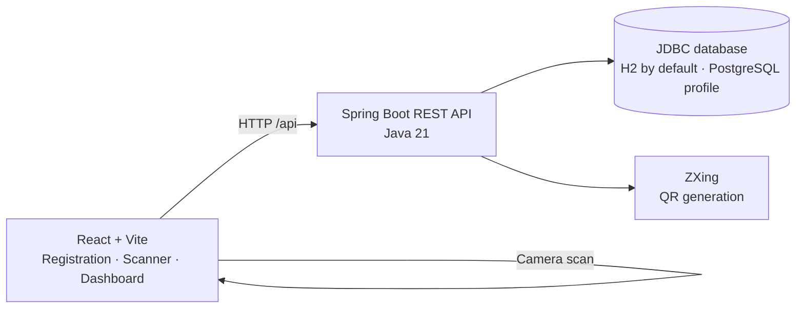
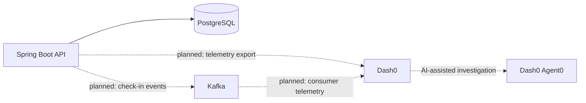

# EventPulse

**Conference check-in, attendance, and reliability — built for the Dash0 + Sonar hackathon.**

EventPulse is a QR-based conference registration and attendance application. Attendees register and receive a unique QR code; event staff scan it in a browser to validate and record check-in. The project is also a foundation for exploring how observability can help diagnose failures in a small distributed system.

> **Project status:** The registration, QR, check-in, and attendance-summary flows are implemented. PostgreSQL, Kafka, and observability dependencies/configuration are represented to varying degrees, but Kafka event processing, Dash0 export, and the planned failure simulations are not yet wired end to end. See [Current capabilities and roadmap](#current-capabilities-and-roadmap).

## What it does

- **Register attendees** with a name and email address.
- **Generate a unique QR code** containing the attendee's check-in link.
- **Scan tickets** with a browser camera using the staff scanner.
- **Validate and check in attendees** while preventing duplicate check-ins.
- **View attendance totals** for registrations, check-ins, and remaining attendees.
- **Run locally with H2**, or opt into the PostgreSQL Spring profile.

## Architecture



The target hackathon story extends this working application with asynchronous check-in events, telemetry export, and deliberately injected failure scenarios:



## Technology

| Area | Technology |
|---|---|
| Frontend | React 19, TypeScript, Vite |
| QR scanning | `html5-qrcode` |
| Backend | Java 21, Spring Boot |
| Database access | Spring JDBC |
| Local database | H2 |
| Optional database | PostgreSQL |
| QR generation | ZXing |
| Messaging foundation | Spring Kafka dependency |
| Observability foundation | Spring Actuator, Micrometer tracing bridge for OpenTelemetry, Prometheus registry |
| Tests | JUnit 5, Spring Boot Test |

## Get started

### Prerequisites

- Java 21
- Node.js and npm
- A modern browser; camera access is needed to use the scanner

### Start the backend

From the repository root:

```powershell
.\mvnw.cmd spring-boot:run
```

The API starts at `http://localhost:8080`. By default, attendee data is stored in the local H2 database at `data/attendees`.

### Start the frontend

In another terminal:

```powershell
cd frontend
npm install
npm run dev
```

Open the local URL printed by Vite. Its development server proxies `/api` requests to `http://localhost:8080`.

For a production frontend bundle:

```powershell
cd frontend
npm run build
```

### Use PostgreSQL (optional)

The `postgres` Spring profile uses the PostgreSQL driver and these environment variables:

| Variable | Default |
|---|---|
| `DATABASE_URL` | `jdbc:postgresql://localhost:5432/eventpulse` |
| `DATABASE_USERNAME` | `eventpulse_user` |
| `DATABASE_PASSWORD` | Not set in the repository; supply it in your environment |
| `APP_BASE_URL` | `http://localhost:8080` |

Provide a running PostgreSQL database and credentials, then start the backend with the profile:

```powershell
$env:DATABASE_PASSWORD = "your-local-password"
.\mvnw.cmd spring-boot:run "-Dspring-boot.run.profiles=postgres"
```

The schema is in [`src/main/resources/schema.sql`](src/main/resources/schema.sql). Do not use a real or shared password in shell history or committed files.

## API

| Method | Path | Purpose |
|---|---|---|
| `POST` | `/api/attendees` | Register an attendee and return attendee details, check-in URL, and a base64-encoded PNG QR code. |
| `GET` | `/api/attendees/summary` | Return `totalRegistered`, `checkedIn`, and `remaining` counts. |
| `POST` | `/api/attendees/{token}/check-in` | Check an attendee in. Returns `404` for an unknown token and `409` if already checked in. |
| `GET` | `/check-in/{token}` | Display a confirmation page for a valid attendee check-in link. |
| `POST` | `/check-in/{token}` | Confirm check-in from the attendee link; repeated submissions show an already-checked-in result. |
| `GET` | `/api/qr?text=...` | Generate a 300 × 300 PNG QR code for the supplied text. |

Example registration request:

```json
{
  "name": "Alex Morgan",
  "email": "alex@example.com"
}
```

The registration endpoint returns `201 Created`. Its response includes `attendeeId`, `name`, `email`, `checkInUrl`, and `qrCodePngBase64`. The check-in API returns the attendee ID and name, check-in status, and timestamp.

## Current capabilities and roadmap

| Area | Status |
|---|---|
| Registration and unique attendee tokens | Implemented |
| QR image generation and browser-based scanning | Implemented |
| Duplicate-safe check-in and attendee confirmation page | Implemented |
| Registration/check-in/remaining attendance totals | Implemented |
| H2 local persistence | Implemented and used by default |
| PostgreSQL profile and schema | Configured; requires a separately provisioned database |
| Kafka event publishing and consuming | Not yet implemented; the Spring Kafka dependency is present |
| OpenTelemetry export to Dash0 and Agent0 investigation | Not yet configured end to end |
| Traffic-spike, database-delay/outage, and Kafka-lag/consumer-failure simulations | Planned; no simulation controls are currently included |
| Sonar analysis and k6 load-test scenarios | Planned |
| Docker Compose deployment | Planned; no Compose file is currently included |

The intended reliability demonstrations are to generate concurrent check-ins, introduce database delays or an outage, and slow or stop a Kafka consumer. Dash0 should then help correlate the resulting API latency, dependency errors, or message backlog; Agent0 can be used to investigate questions such as *“Why has check-in latency increased over the last two minutes?”*

## Tests

Run the backend tests from the repository root:

```powershell
.\mvnw.cmd test
```

The frontend build includes a TypeScript check:

```powershell
cd frontend
npm run build
```

## Repository layout

```text
.
├── frontend/
│   └── src/                 # Registration, scanner, dashboard, and styles
├── src/
│   ├── main/java/           # Spring Boot API and services
│   ├── main/resources/      # Application profiles and SQL schema
│   └── test/java/           # Backend tests
├── data/                    # Local H2 database files (git-ignored)
├── mvnw                     # Maven wrapper (Unix)
└── mvnw.cmd                 # Maven wrapper (Windows)
```
